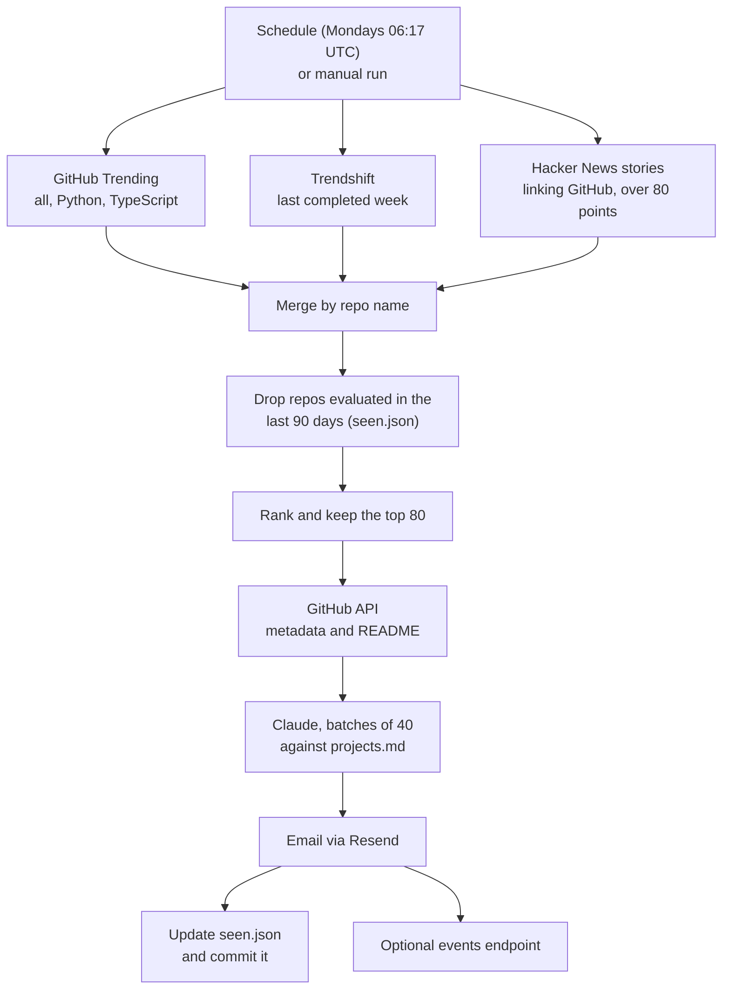

# repo-radar

A weekly GitHub Actions job that collects trending open-source repositories and asks Claude
which of them are relevant to your own projects. It reads GitHub Trending, Trendshift's weekly
list and GitHub links posted to Hacker News, skips anything it evaluated in the last 90 days,
fetches each candidate's metadata and README from the GitHub API, and sends the candidates plus
your project descriptions (`projects.md`) to Claude. Repos that fit a project with confidence 3
or higher are emailed to you through Resend, grouped by project. The email goes out every week,
also when nothing matched.

## How it works



1. **Collect.** Three GitHub Trending pages (weekly; all languages, Python, TypeScript); the
   Trendshift weekly list for the last completed week; Hacker News stories from the last 7 days
   with more than 80 points whose URL is a GitHub repository (Algolia search API). If Trending
   yields fewer than 10 repos the run fails, because that means its markup changed. Trendshift
   and Hacker News are optional: if either fails, the run continues without it.
2. **Filter.** Repos are merged case-insensitively. Any repo whose last evaluation in
   `seen.json` is less than 90 days old is dropped.
3. **Rank.** Hacker News repos come first (by points), then Trendshift repos (by rank), then the
   remaining Trending repos (by stars gained this week). The list is cut to 80 candidates.
4. **Enrich.** For each candidate, the GitHub API returns description, stars, language, topics,
   last push date and the README (badges, images and HTML removed, first 1,500 characters).
5. **Match.** Candidates go to Claude in batches of 40, together with the full text of
   `projects.md`. The response is constrained to a JSON schema: every repo is either a finding
   (project, category, reason, next step, confidence 1 to 5) or skipped with a short reason.
6. **Report.** One email per run. Findings with confidence 3 or higher are listed in full; the
   rest are listed at the bottom.
7. **Remember.** If the email was accepted by Resend, every repo the model returned is written to
   `seen.json`, and the workflow commits that file back to the repository. If the email failed,
   `seen.json` is left unchanged so the findings are not hidden for 90 days.

## Quick start

1. Click **Use this template** on [github.com/ziki17/repo-radar](https://github.com/ziki17/repo-radar)
   to create your own repository. Choose **Private** if `projects.md` will describe work that is
   not public: `projects.md` and `seen.json` are committed to the repository.
2. Create a [Resend](https://resend.com) account and verify a domain you can send from.
3. In your repository, under **Settings > Secrets and variables > Actions**, add:
   - Secrets: `ANTHROPIC_API_KEY`, `RESEND_API_KEY`, `RECIPIENT_EMAIL`.
   - Variables: `EMAIL_FROM` (for example `Repo Radar <radar@example.com>`, on the domain you
     verified in Resend) and `RADAR_ENABLED` set to `true`.
4. Replace the example projects in `projects.md` with your own (see below).
5. Go to **Actions > Repo Radar > Run workflow** and run it once. Tick `dry_run` first if you
   want to see the output in the job log without sending an email or changing `seen.json`.

After that the job runs every Monday at 06:17 UTC. Without `RADAR_ENABLED=true`, scheduled runs
are skipped (shown as skipped, not failed), so a copy without secrets stays green. Manual runs
always start.

## Configuration

| Name | Kind | Required | Purpose |
| --- | --- | --- | --- |
| `ANTHROPIC_API_KEY` | Secret | Yes (not for `--dry-run`) | Claude API key. Without it a normal run fails after collection; a dry run skips matching. |
| `RESEND_API_KEY` | Secret | Yes | Resend API key used to send the report. |
| `RECIPIENT_EMAIL` | Secret | Yes | The single address the report is sent to. |
| `EMAIL_FROM` | Variable | Yes (not for `--dry-run`) | Sender, e.g. `Repo Radar <radar@example.com>`. Must be on a domain verified in Resend. |
| `RADAR_ENABLED` | Variable | For scheduled runs | Set to `true` to let the weekly schedule run. Read by the workflow only. |
| `DASHBOARD_URL` | Secret | No | Base URL of an HTTP endpoint that receives run events (see below). |
| `DASHBOARD_TOKEN` | Secret | No | Bearer token for that endpoint. Events are sent only when both are set. |
| `GITHUB_TOKEN` | Provided by Actions | No | Used for GitHub API calls. Locally, without it, requests are anonymous and hit GitHub's lower rate limit sooner. |

If `EMAIL_FROM` is missing, the run stops before collecting anything and logs
`FAILED: RuntimeError: EMAIL_FROM is not set; ...`. If `RESEND_API_KEY` or `RECIPIENT_EMAIL` is
missing, the run collects and matches as usual, then logs `Email not configured` and exits with
an error without updating `seen.json`.

Command-line options of `radar.py`:

| Option | Default | Effect |
| --- | --- | --- |
| `--dry-run` | off | No email, no events, no `seen.json` or `last_run.json`. Prints the email HTML and the findings JSON. |
| `--max-candidates N` | 80 | Number of repos sent to Claude. |
| `--days N` | 7 | Hacker News look-back window in days. |

The workflow exposes `--dry-run` as the `dry_run` input of a manual run.

### Optional events endpoint

When `DASHBOARD_URL` and `DASHBOARD_TOKEN` are both set, each non-dry run sends events to any
HTTP endpoint you provide:

- `POST {DASHBOARD_URL}/api/events` (a trailing slash on the URL is removed)
- Header `Authorization: Bearer {DASHBOARD_TOKEN}`
- JSON body: `{"agent": "repo-radar", ...event}`
- A response other than `201` is logged; network errors are logged. Neither fails the run.
  Timeout is 5 seconds.

Events per run:

- One `finding` event per finding with confidence 3 or higher:
  `kind`, `status` (`"ok"`), `ref` (`owner/repo`), `url`, `project`, `title`
  (`"owner/repo: category"`), `summary` (the next step), and `data` with `why`, `confidence`,
  `stars`.
- One `run` event at the end: `kind`, `status` (`"ok"`, or `"fail"` if the email was not sent),
  `title`, and `data` with the counts `trending`, `trendshift`, `hn`, `evaluated`, `findings`,
  `actionable` and the boolean `email_sent`.
- If the run crashes, a single `run` event with `status` `"fail"`, a `title` naming the error
  type, and a `summary` with the first 500 characters of the error message.

## Writing projects.md

`projects.md` is the only description of your projects the model sees. It is sent verbatim
inside every request, so its length adds to the cost of each batch.

- Keep the list of the four categories (`security`, `replace`, `pain`, `capability`) near the
  top. The system prompt tells the model to report a repo only if it fits one of the categories
  "defined in the profiles", and the response schema allows only these four values.
- Give each project its own `##` heading. The model reports the project name it sees there, and
  the email groups findings under that name.
- Under each project, list what the categories refer to: the **Stack** (for security advisories),
  what you **hand-rolled** (for libraries that could replace it), **pain points** and a
  **wishlist**. Be specific: "PDF generation times out on large invoices" gives the model
  something to match; "performance" does not.
- Write down decisions the model should respect, for example a tool you removed on purpose.

The file in this repository contains three fictional examples in this format.

To have a repo evaluated again before its 90 days are up, delete its entry from `seen.json`.
To start over, set `seen.json` to `{}`.

## What the email contains

The subject is `repo-radar: N findings for week YYYY-Www` (ISO week), or `no findings` when
nothing reached confidence 3.

The body starts with the week. Findings with confidence 3 or higher follow, grouped under their
project name and sorted by confidence. Each finding shows the repository name linked to GitHub,
its category, the confidence out of 5, the star count (plus stars gained this week when it came
from Trending), a link to the Hacker News discussion with its points and a link to its
Trendshift rank when it came from those sources, the model's reason, and one suggested next
step. If no finding reached confidence 3, the body says "No actionable findings this week."

At the bottom, "Also evaluated" lists every other repo of the run in one line each: low-confidence
findings with their confidence and the start of the reason, skipped repos with the model's skip
reason, and repos the model did not return marked as `not returned by model`. Repos in that last
group are not written to `seen.json`, so they are evaluated again next week.

## Cost and limits

- Model: `claude-sonnet-5-5`, structured JSON output, `max_tokens` 16,000 per request. A refusal
  is retried by the API on a fallback model (server-side fallback beta).
- Requests: candidates are capped at 80 by default and sent in batches of 40, so a normal run
  makes 2 Claude requests. Each request contains the full `projects.md` and, per candidate, up
  to 1,500 characters of README.
- GitHub API: 2 requests per candidate (repository and README).
- Hacker News: up to 5 pages of 200 stories from the last 7 days with more than 80 points.
- Seen window: 90 days.
- Schedule: Mondays 06:17 UTC; the job times out after 20 minutes.
- A run fails if Claude refuses a batch, its output hits `max_tokens`, or Trending returns fewer
  than 10 repos.

## Running locally

Requires Python 3.12.

```sh
python3.12 -m venv .venv
.venv/bin/pip install -r requirements.txt pytest ruff
GITHUB_TOKEN=$(gh auth token) .venv/bin/python radar.py --dry-run --max-candidates 15
```

The dry run without `ANTHROPIC_API_KEY` exercises collection and enrichment only. Set
`ANTHROPIC_API_KEY` to also see the model's findings. A run without `--dry-run` needs every
required setting from the table above as environment variables, sends the email and writes
`seen.json` and `last_run.json` (the latter is gitignored).

Tests and lint:

```sh
.venv/bin/python -m pytest -q
.venv/bin/ruff check .
```

The tests use fake HTTP sessions and a fake Anthropic client; they make no network calls.

## License

MIT, see [LICENSE](LICENSE).
